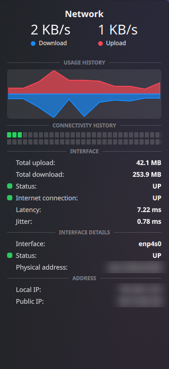
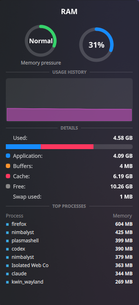
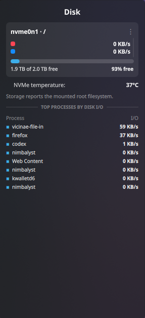
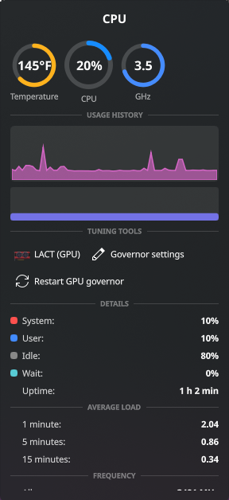

# Stats Bar

A compact, macOS [Stats](https://github.com/exelban/stats)-style system monitor for the
**KDE Plasma 6** panel. Network up/down, RAM, SSD and CPU sit next to your clock, and each
one opens a detailed dropdown when you click it. Nothing pops up on hover.


| Network | RAM | Disk | CPU |
|---|---|---|---|
|  |  |  |  |

Built and tested on an **AMD BC-250** (the PS5-derived "Cyan Skillfish" board) running
CachyOS + Plasma 6.8. It's not BC-250 specific, though, and should work on any Plasma 6 machine.
On a BC-250 with the 8-core unlock you'll see all 16 threads in the CPU dropdown.

## What's in the dropdowns

- **Network**: live download/upload, mirrored usage graph, connectivity history (ping squares),
  totals since boot, latency and jitter, interface, MAC address, local and public IP
- **RAM**: pressure gauge, usage ring, history, application/buffers/cache/free breakdown,
  swap, and the top processes by memory
- **Disk**: the disk behind `/` (auto-detected) with read/write rates and graph, free space,
  NVMe temperature, and the top processes by disk I/O
- **CPU**: temperature (°F), usage and clock rings, history, a bar per thread, system/user/idle/wait,
  uptime, load averages, frequency range, and the top processes by live CPU use. Its tuning section
  can open LACT and, when present, the Cyan Skillfish governor settings.

## Install

From Plasma: **right-click the panel → Add Widgets → Get New Widgets → Download New Plasma Widgets**,
search for "Stats Bar", then drag it onto your panel.

Or from source:

```sh
git clone https://github.com/ThumosMalorus/statsbar.git
kpackagetool6 -t Plasma/Applet -i statsbar
# update later with: kpackagetool6 -t Plasma/Applet -u statsbar
```

Then right-click the panel → **Add Widgets** → search "Stats Bar".

### Requirements

- KDE Plasma 6 (uses `ksystemstats`, which ships with Plasma)
- `procps-ng` (`ps`, `top`), `iproute2`, `util-linux` (`lsblk`, `findmnt`), coreutils: already present on most distros
- Optional: `lm_sensors` for the NVMe temperature, `curl` for the public IP
- Optional: Kate and KDE's `kio-admin` for editing system-wide governor settings; LACT and governor
  controls appear only when their software is available

## Resource use

The panel readout uses five `ksystemstats` sensors at a 2-second rate. Everything else
(per-thread bars, process lists, disk detection) only runs while a dropdown is open.
On the BC-250, `ksystemstats` uses about 36 MB of RAM, and plasmashell showed no measurable
growth after adding the widget.

## Privacy

- It pings `1.1.1.1` once a minute (every 5 s while a dropdown is open) for the
  connectivity squares, latency and jitter.
- The public IP is fetched from `api.ipify.org`, only while the Network dropdown is open and
  at most every 10 minutes.

## Credits

Look and layout inspired by [exelban/Stats](https://github.com/exelban/stats) for macOS.
Built with help from Claude Code and OpenAI Codex.

## License

GPL-2.0-or-later
